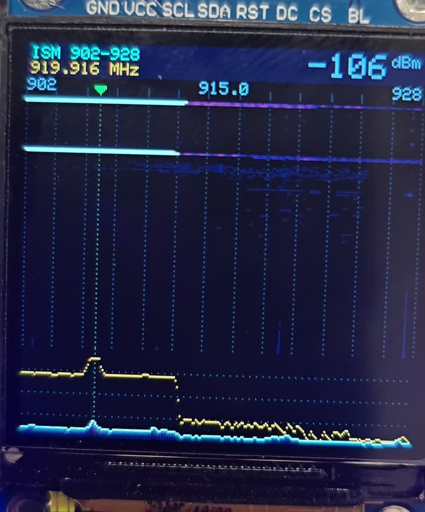
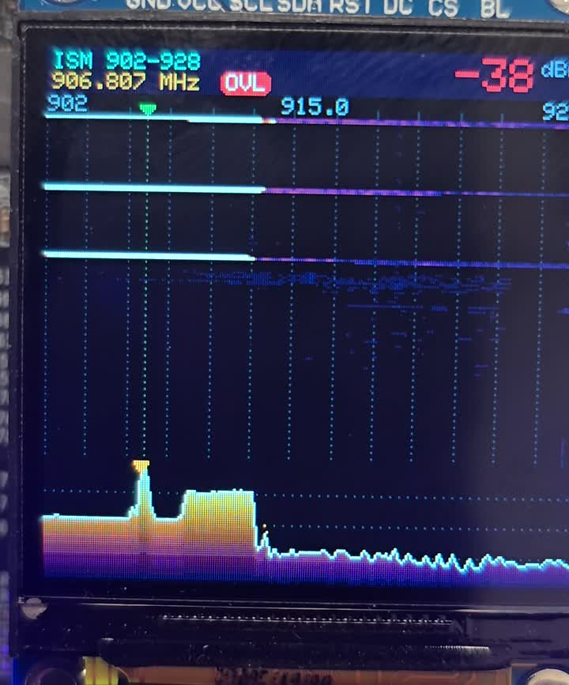

# W10 ISM Waterfall

A standalone handheld spectrum waterfall for the US 902–928 MHz ISM band, running on the
[Meshnology W10 LoRa AIoT Dev Kit](https://meshnology.com/products/meshnology-w10-lora-aiot-dev-kit-esp32-s3-long-range-iot-development-board)
(ESP32-S3 + EBYTE E22-900MM22S / SX1262) with its 1.54" 240×240 display.

No laptop, SDR or phone app needed. Receive-only.

| Normal view | Nearby node transmitting (overload) |
|---|---|
|  |  |

## What it does

- Sweeps 902–928 MHz with the SX1262 and reads instantaneous RSSI at each step
- Full band refreshes about **4.6 times per second** (120 steps, 250 kHz bandwidth); spans of 10 MHz or less switch to 240 steps at 125 kHz
- **Waterfall** with an inferno-style color scale: noise floor stays black, signals glow purple → orange → yellow → white
- **Live spectrum** with gradient fill, dB grid, peak-hold and a marker on the strongest signal
- **Header** with peak level (dBm), peak frequency, and a red **OVL** badge when a signal is strong enough (> −60 dBm) to overload the receiver
- Green marker and dotted guide at **906.875 MHz** (US Meshtastic LongFast default)
- **Audio:** short beep through the onboard ES8311 codec + speaker when a signal rises 15 dB above the noise floor; pitch rises with strength (Geiger-counter style)
- **Auto-calibration:** measures the RX settle time at boot and picks the shortest reliable dwell

## Controls

| Action | Result |
|---|---|
| Tap **BOOT** | Cycle span: ISM 902–928 → Meshtastic US 904–910 → LoRaWAN uplink 902–915 |
| Hold **BOOT** ~1 s | Sound on / off |

Tilt-to-zoom using the QMI8658 IMU is implemented but disabled by default (`tiltControl()` call commented out in `loop()`).

## Hardware notes (W10)

Pin mapping comes from Meshnology's W10 Arduino demos:

| Function | Pins |
|---|---|
| I2C (all sensors, MCP23017) | SDA = GPIO8, SCL = GPIO7, run at ~10 kHz during init |
| Shared SPI (LoRa + LCD) | SCK = 12, MOSI = 13, MISO = 11 |
| LoRa NSS | GPIO14 |
| LoRa NRST / BUSY / DIO1 | via MCP23017 (0x20): GPA3 / GPB2 / GPB1 |
| LCD (ST7789 240×240) | CS = 10, DC = 16, BL = 6, RST = MCP23017 GPA1 |
| Speaker amp enable | MCP23017 GPA7 |
| I2S to ES8311 | MCLK = 1, BCK = 2, LRCK = 4, DOUT = 5, DIN = 3 |

I2C devices found on the board: ES8311 (0x18), MCP23017 (0x20), AXP2101 (0x34), SHT41 (0x44), PCF85063 (0x51), QMI8658 (0x6B).

The radio and display are driven with raw register/command access (no RadioLib, no display driver library). The only external library is **Adafruit GFX** for text and shapes.

## Build

Arduino IDE 2.x with the **esp32 by Espressif** core (3.x).

Board: **ESP32S3 Dev Module**, with:

- USB CDC On Boot: **Enabled**
- PSRAM: **OPI PSRAM**
- Flash Size: 4 MB or larger (the W10 has 16 MB)

Library: **Adafruit GFX Library** (Library Manager).

Open `w10_ism_waterfall/w10_ism_waterfall.ino` and upload. If the board doesn't accept the first
upload (some factory firmware blocks auto-reset), hold **BOOT**, tap **RESET**, release **BOOT**, upload,
then tap **RESET** once more.

Serial monitor at 115200 baud shows the radio diagnostics, burst log and sweep rate.

## Things it's useful for

- Site surveys before placing Meshtastic or LoRaWAN nodes
- Spotting interference or a raised noise floor on your channel
- Confirming a node is actually transmitting, on the right frequency, at a sensible level
- Seeing when a node is close enough to overload nearby receivers (the OVL badge)
- Teaching and demos: LoRa bursts show up live

## Limitations

- RSSI sweep, not a true SDR: it shows signal energy per step, not demodulated data
- A very strong nearby transmitter overloads the front end and raises the readings roughly ±8 MHz around it (that's what the OVL badge flags)
- Dark tones on this panel render brighter than expected, so the UI colors are gamma-corrected

## License

MIT, see [LICENSE](LICENSE).

## Credits

Built by Anubis Darkwatch with Claude. Pin mapping and peripheral details from Meshnology's W10 documentation and demos.
